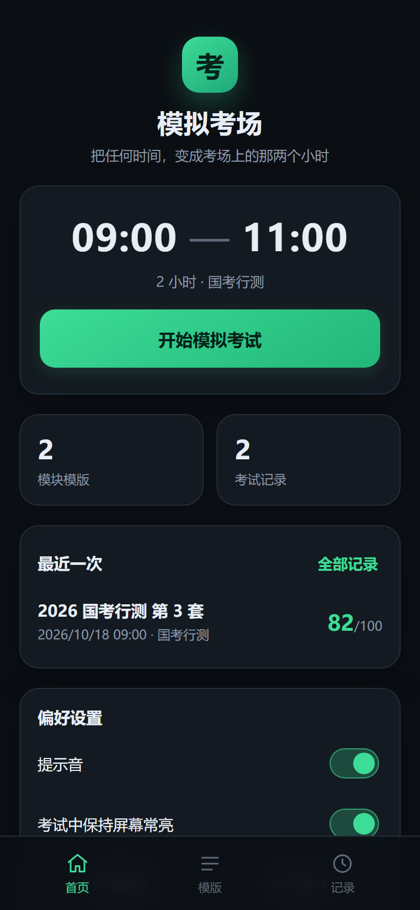
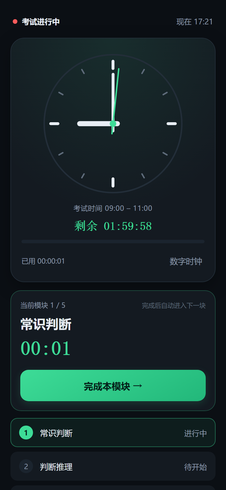
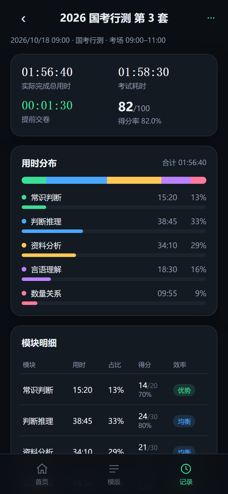

# 模拟考场（Mock Exam Clock）

一个「虚拟考场时钟 + 模块计时 + 成绩分析」的 App：在任意真实时间，把时钟拨到考试的
09:00–11:00，像在考场一样做题、按模块计时，交卷后看用时与得分分析。

本仓库包含两套实现：

| 目录 | 实现 | 状态 |
| --- | --- | --- |
| `web/` | **PWA（原生 ES Module，零依赖、零构建）**，iPhone Safari 可直接用、可添加到主屏幕、可离线 | 已在本机跑通并截图验收 |
| `ios/` | **SwiftUI 原生 Xcode 工程**（iOS 17+） | 源码与工程文件已生成，**未在 Mac 上编译验证** |
| `docs/` | 产品与数据规格、UI 截图 | — |

需求与数据模型见 [`docs/SPEC.md`](docs/SPEC.md)，两套实现的字段与算法一致。

---

## 1. 立刻用起来（Web / PWA）

```bash
node tools/serve.mjs 8123        # 启动本地静态服务（默认目录 web/）
```

- 电脑浏览器打开 <http://localhost:8123/>
- **手机访问**：手机与电脑连同一个 Wi-Fi，浏览器打开 `http://<电脑局域网IP>:8123/`
  （服务启动时会打印可用的局域网地址；Windows 首次可能弹出防火墙提示，允许「专用网络」即可）
- **装到桌面**：iPhone Safari → 分享 → 「添加到主屏幕」。之后从桌面图标打开是全屏的，没有地址栏。

> 说明：iOS 只在 HTTPS 或 localhost 下允许 Service Worker（离线缓存）。局域网 http 访问时功能全部可用，
> 只是没有离线缓存——**一旦关掉电脑上的服务，手机就打不开了**。
> 想让手机真正离线使用，见下一节。

### 1.1 部署到 GitHub Pages（推荐，一次配置长期可用）

仓库里已经准备好了 [`.github/workflows/pages.yml`](.github/workflows/pages.yml)：推送到 `main` 后，
Actions 只把 `web/` 目录发布成站点，`ios/`、`docs/` 不会上网。得到一个固定 HTTPS 地址后，
手机首次打开一次，之后断网、关服务器都能用。

完整步骤（含两种方案、更新流程、数据迁移、常见问题）见
[`docs/DEPLOY-GITHUB-PAGES.md`](docs/DEPLOY-GITHUB-PAGES.md)。

### 常用命令

```bash
node tools/test-core.mjs     # 纯逻辑单元测试（时间换算、分析算法）
node tools/smoke-dom.mjs     # 端到端流程冒烟测试（用 DOM 桩驱动真实 app.js）
node tools/shots.mjs         # 生成界面截图（需先启动 http://127.0.0.1:9222 的 headless Chrome）
node tools/make-icons.py     # 重新生成图标（需要 Pillow）
```

---

## 2. iOS 原生版

```
ios/MockExamClock.xcodeproj     ← 用 Xcode 打开
ios/MockExamClock/*.swift       ← SwiftUI 源码
ios/README.md                   ← 该端单独的构建说明与限制
```

打开方式：Mac 上 `open ios/MockExamClock.xcodeproj` → 选择模拟器或真机 → Run。
真机运行需要在 Signing & Capabilities 里选择自己的开发者 Team，并把 bundle id
（默认 `com.harness.mockexamclock`）改成你自己的唯一标识。

**当前限制**：这份工程是在 Windows 上生成的，没有经过 Xcode 编译，可能需要 1–2 处小修
（最可能出现在 `project.pbxproj` 或某个 API 的可用性标注上）。如果你有 Mac，把报错贴给我，我按错误改。

---

## 3. 功能

### 3.1 虚拟考场时钟
- 设定 **开始时间 / 结束时间**（如 09:00–11:00），点「开始考试」后时钟就从 09:00 走起，
  与手机上的真实时间无关；右上角小字仍显示真实时间，方便对表。
- **数字时钟 / 表盘时钟** 两种显示，考场挂钟风格的表盘用 SVG 绘制。
- 显示 **剩余时间**、已用时间、进度条；最后 5 分钟变红闪烁；到点自动收卷并响铃。
- 支持跨零点（23:00–01:00 = 120 分钟）；结束时间等于开始时间按 24 小时处理。
- 考试中保持屏幕常亮（Wake Lock），切到后台再回来会重新申请。

### 3.2 模块计时
- 开考前可选择 **模块模版**，或不选（自动生成「模块一、模块二…」，个数 2–8 可调）。
- 考试中点「完成本模块」记录该模块用时并自动进入下一块；「撤销上一个」可重来（重新计时）。
- 最后一个模块完成会提示交卷；也可以随时「提前交卷」或「放弃本场」（放弃不留记录）。
- 计时全部基于时间戳差值，切后台、锁屏、刷新页面都不会漂移；杀掉进程回来会提示「继续未完成的考试」。

### 3.3 模版
- 新建 / 编辑 / 删除模版；每个模块可填「满分」，也可以不填；模块可上移、下移。
- 模版改名或删除不会影响已产生的历史记录（考试里保存了快照）。

### 3.4 考试分析
- **实际完成总用时**（各模块用时之和）、**考试耗时**、提前 / 超时 / 压线。
- 用时分布堆叠条 + 每个模块的用时占比。
- 模块明细表：用时、占比、得分 / 满分、得分率、效率标签（优势 / 均衡 / 低效 / 重头 / 轻量 / 未开始）。
- 自动生成 3–5 条分析文字：用时最多的模块、得分率最高最低、投入产出最差的模块并给出建议压缩多少分钟。
- **得分可后填**：交卷时可以先不填，之后在记录里随时补录；填了考试总分才显示得分率，
  所有模块都填了得分才做「用时占比 vs 得分占比」的效率对比。
- 模块得分合计与总得分不一致时会提示，避免漏填。
- 一键复制文本版分析、导出 / 导入 JSON 备份。

### 3.5 数据
- 全部数据只存在本机（Web 用 `localStorage`，iOS 用 `Application Support/mockexam.json`），无账号、无后端、无网络请求。
- 备份文件是纯 JSON，换设备用「导出备份 / 导入备份」搬运。

---

## 4. 界面

`docs/shots/` 下有全部截图（在 390×844 的 iPhone 视口下用 headless Chrome 实拍）：

| 首页（深色） | 考试中（表盘） | 结果分析 |
| --- | --- | --- |
|  |  |  |

浅色模式另有 `01-home.png`、`07-result-top.png` 等。

---

## 5. 目录结构

```
web/                  PWA
  index.html
  styles.css
  js/core.js          纯逻辑：时间换算、虚拟时钟、分析算法（可在 Node 中测试）
  js/store.js         localStorage 持久化
  js/app.js           视图与交互
  manifest.webmanifest
  sw.js               Service Worker（离线缓存）
  icons/              应用图标
ios/                  SwiftUI 原生工程
docs/SPEC.md          产品与数据规格
docs/shots/           界面截图
tools/               本地服务器、测试、截图、图标生成脚本
```

---

## 6. 已知限制与后续可做

- iOS 原生版本未编译验证（见上）。
- Web 版在 iOS 上无法震动（`navigator.vibrate` 不支持），到点提醒依赖提示音 + 界面高亮；
  原生版有震动反馈。
- Web 版完全离线需要 HTTPS（Service Worker 限制）。
- 可继续做：模版里给每个模块加「建议用时」并与实际对比、多次模考趋势图、错题/正确率录入、
  导出长图分享、iCloud/CloudKit 同步、Apple Watch 计时。
