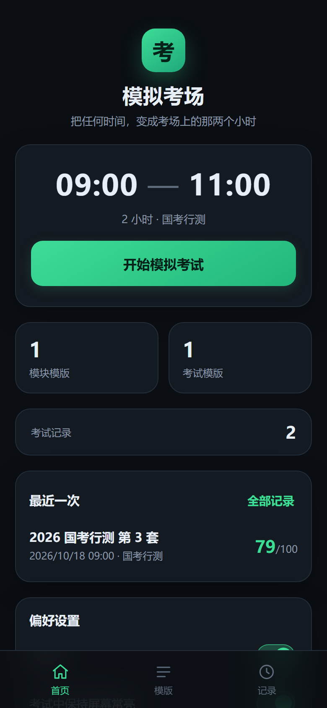
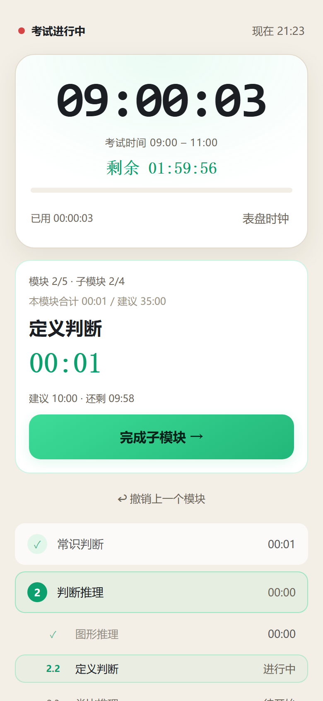
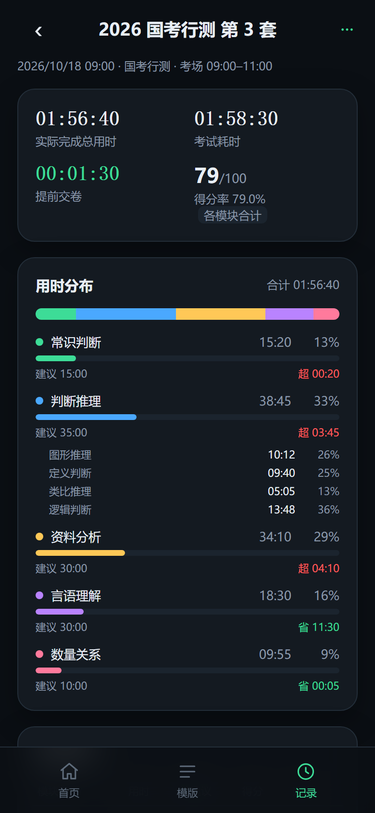

# 模拟考场（Mock Exam Clock）

一个「虚拟考场时钟 + 模块计时 + 成绩分析」的 App：在任意真实时间，把时钟拨到考试的
09:00–11:00，像在考场一样做题、按模块计时，交卷后看用时与得分分析。

| 目录 | 实现 | 状态 |
| --- | --- | --- |
| `web/` | **PWA**（原生 ES Module，零依赖、零构建），iPhone Safari 可添加到主屏幕、可离线 | **v2，已跑通并截图验收** |
| `ios/` | SwiftUI 原生 Xcode 工程（iOS 17+） | **v1 源码，尚未同步 v2 功能，且未在 Mac 上编译** |
| `docs/` | 产品与数据规格、部署说明、UI 截图 | — |

需求与数据模型见 [`docs/SPEC.md`](docs/SPEC.md)；上线部署见 [`docs/DEPLOY-GITHUB-PAGES.md`](docs/DEPLOY-GITHUB-PAGES.md)。

---

## v2 新增

1. **二级模块**：模块下面可挂子模块，考试时逐个子模块计时，用时自动汇总到一级模块；
2. **考试模版**：预设考试名称、默认起止时间、默认模块模版、默认总分，新建考试一键带出；
3. **题目数与每题分值**：模版里填「题目数 / 每题分值」，交卷后只填**正确题数**即可自动算分
   （每题分值不填按 1 分）；总分 = 各模块合计，**手填总分优先**；
4. **建议用时**：每个模块（和子模块）可设建议用时，考试中提示「还剩 / 已超出」，分析里对比实际用时。

---

## 1. 立刻用起来（Web / PWA）

```bash
node tools/serve.mjs 8123        # 启动本地静态服务（默认目录 web/）
```

- 电脑浏览器 <http://localhost:8123/>
- **手机访问**：手机与电脑同一 Wi-Fi，打开 `http://<电脑局域网IP>:8123/`（启动时会打印地址）
- **装到桌面**：iPhone Safari → 分享 → 添加到主屏幕，之后全屏、无地址栏

> ⚠️ 局域网 http 地址在 iOS 上**无法注册 Service Worker**，关掉电脑上的服务就打不开了。
> 想真正离线使用，必须部署到 HTTPS（见下）。

### 1.1 部署到 GitHub Pages（推荐）

仓库里已备好 [`.github/workflows/pages.yml`](.github/workflows/pages.yml)：推送到 `main` 后只发布 `web/`
目录。得到 `https://<用户名>.github.io/<仓库名>/` 后，手机打开一次即完成离线缓存，之后断网可用。

完整步骤（含两种方案、更新流程、数据迁移、常见问题）见
[`docs/DEPLOY-GITHUB-PAGES.md`](docs/DEPLOY-GITHUB-PAGES.md)。

### 常用命令

```bash
node tools/test-core.mjs     # 纯逻辑单元测试（21 项：时间、二级模块、计分、建议用时、分析）
node tools/smoke-dom.mjs     # 端到端流程测试（15 项，DOM 桩驱动真实 app.js）
node tools/shots.mjs         # 重新出图（需 headless Chrome @9222）
node tools/make-icons.py     # 重新生成图标（需要 Pillow）
```

---

## 2. 功能

### 2.1 虚拟考场时钟
- 设定开始/结束时间，点「开始考试」后时钟从 09:00 走起，与手机真实时间无关；右上角小字显示真实时间。
- 数字时钟 / 表盘时钟（SVG 挂钟）两种；剩余时间、已用时间、进度条；最后 5 分钟变红；到点响铃自动收卷。
- 支持跨零点（23:00–01:00 = 120 分钟）；考试中保持屏幕常亮；切后台回来按时间戳重算；杀进程可恢复。

### 2.2 模块与二级模块计时
- 开考前选模块模版，或不选（自动生成「模块一…」，2–8 个）。
- 一级模块可挂二级模块：考试时逐个子模块计时，父模块用时 = 子模块之和。
- 「完成本模块 / 完成子模块」记时并自动进入下一段；「撤销上一个」回退并清零重计。
- 每个模块/子模块可设建议用时，超时提示变红。

### 2.3 模版
- **模块模版**：模块名、建议用时、题目数、每题分值、满分（选填）、二级模块列表；可排序、增删。
- **考试模版**：名称、默认起止时间、默认模块模版（或模块数量）、默认总分。新建考试时一键套用，仍可手改。

### 2.4 考试分析
- 实际完成总用时、考试耗时、提前/超时/压线、统计总分与得分率。
- 用时分布（含子模块占比）、模块明细（用时 / 较建议 ± / 得分 / 效率）。
- 得分录入：有题目数填正确题数自动算分，否则直接填模块得分；总分不填按合计、填了以手填为准。
- 自动分析 3–5 条：用时最多、超建议、得分率高低、性价比最低/最高、提前或超时。
- 复制文本报告、删除记录、导出/导入 JSON 备份。

### 2.5 数据
全部只存本机（Web `localStorage`、iOS `Application Support`），无账号无后端；v1 数据自动升级到 v2。

---

## 3. 界面

`docs/shots/` 下是 390×844 视口的实拍截图：

| 首页（深色） | 考试中（二级模块 + 建议用时） | 结果分析 |
| --- | --- | --- |
|  |  |  |

模版编辑、考试模版、得分录入见 `docs/shots/11-template-editor.png`、`13-exam-template-editor.png`、`08-result-score.png`。

---

## 4. 目录结构

```
web/                  PWA
  index.html
  styles.css
  js/core.js          纯逻辑：虚拟时钟、二级模块、计分、分析（可在 Node 中测试）
  js/store.js         localStorage 持久化 + v1→v2 迁移
  js/app.js           视图与交互
  manifest.webmanifest / sw.js / icons/
ios/                  SwiftUI 原生工程（v1，待同步）
docs/SPEC.md          产品与数据规格 v2
docs/DEPLOY-GITHUB-PAGES.md
docs/shots/           界面截图
tools/                本地服务器、测试、截图、图标脚本
```

---

## 5. 已知限制

- **iOS 原生版还是 v1**：没有二级模块、考试模版、题目数计分、建议用时；且这份工程在 Windows 上生成，未编译验证。
- Web 版在 iOS 上不能震动，到点提醒靠提示音 + 界面高亮。
- 完全离线需要 HTTPS（GitHub Pages 即可）。
- 分数只接受非负数；正确题数超过题目数只做软提示，不强制。
